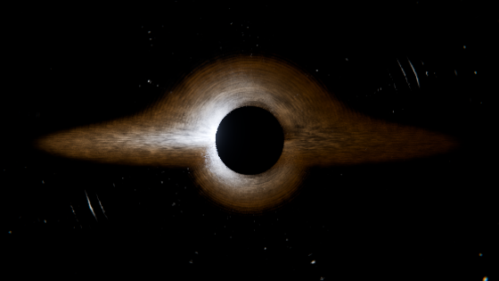

# Kerr Black Hole — a physically derived Cycles render

A cinematic rotating (Kerr) black hole, rendered in Blender Cycles and driven
entirely from Python + NumPy.

Nothing here is painted on. The shadow, the photon ring, the Einstein arcs in
the star field and the lopsided glare of the disk are all *consequences* of
integrating null geodesics — there is not a single ColorRamp faking a glow.



---

## Quick start

```bash
python -m venv .venv && . .venv/bin/activate
pip install -r requirements.txt

python main.py --validate            # physics self-checks, no rendering
python main.py --preview             # one frame, fast
python main.py --render-and-encode   # 4K sequence -> output/black_hole_4k.mp4
```

`bpy` is the Blender Python module from PyPI, so **no Blender installation is
required**. The scripts also run inside a normal Blender if you prefer:

```bash
blender -b -P main.py -- --preview
```

### Entry points

| command | what it does |
|---|---|
| `python main.py --preview` | builds the scene, saves the `.blend`, renders a single frame at preview quality |
| `python main.py --render` | renders the whole frame sequence to `output/frames_<quality>/` |
| `python main.py --render-and-encode` | the above, then muxes `black_hole_4k.mp4` with FFmpeg |
| `python main.py --encode-only` | re-encode existing frames (change CRF without re-rendering) |
| `python main.py --validate` | runs the physics test suite |
| `python main.py --build-only` | builds the scene and saves the `.blend`, renders nothing |

Useful flags: `-q {thumb,preview,high,final}`, `--resolution W H`, `--samples`,
`--shells`, `--seconds`, `--spin`, `--frame`, `--start/--end`, `--overwrite`,
`--crf`, `--output-dir`.

The frame loop is **resumable** — re-running `--render` skips frames that
already exist, so an interrupted 4K run picks up where it stopped.

---

## How the light bending actually works

This is the part that distinguishes the image from a glowing sphere, so it is
worth being precise about.

Cycles is a straight-line ray tracer. To curve light inside it, the scene
contains a stack of **nested transparent spheres** ("shells") between
`r_min = 1.05 r_s` and `r_max = 45 r_s`, each carrying a **Ray Portal BSDF**.
A Ray Portal lets a shader specify where a ray continues *and in which
direction*. So every time a ray crosses a shell, the shader:

1. reads the hit position `P` and the incoming direction `v`,
2. integrates the null-geodesic acceleration over the segment to the next
   shell,
3. hands Cycles back a slightly rotated direction.

Stack a hundred of those and the ray follows a genuine geodesic. The shells
are **logarithmically spaced**, which puts the integration steps where the
curvature is, not where the volume is.

The per-step acceleration is the exact Schwarzschild/Binet term

```
a(x) = -3/2 · h² · x / |x|⁵            h = |P × v|
```

plus a Lense-Thirring frame-dragging term `ω × v` with `ω = (a*/2r³) ẑ`, which
is what makes the lensing visibly *asymmetric* about the spin axis.

Each step uses **Simpson's rule** over the segment, inside a **symmetric
leapfrog split** with a two-pass predictor–corrector. That combination matters:
a naive forward Euler kick at the shell boundary accumulates a systematic
inward bias and quietly shrinks the shadow. The scheme here is time-symmetric,
so it converges cleanly (see the convergence row in `--validate`).

### The shadow edge is solved, not integrated

Near the critical impact parameter `b_c = 3√3/2 ≈ 2.598 r_s` the photon orbit
is an unstable separatrix: the winding number diverges logarithmically, and
*any* finite shell scheme develops a chaotic band a few percent wide right
where the shadow edge lives. Early renders showed exactly that — a ragged,
undersized shadow with noise sprayed around it.

So the shader does not integrate that region at all. A Schwarzschild photon
has a turning point **iff** its impact parameter exceeds `b_c`, so an
inward-moving ray with `b < b_c` is already doomed. The shader evaluates

```
b = |P × v| / √(1 − r_s/r)         (|P × v| is not b — it shrinks as r falls)
```

at every crossing and absorbs the ray analytically when `b < b_c` and the ray
is inbound (`physics.is_doomed`). The shadow therefore lands at exactly
2.598 r_s with a clean edge, and — a welcome side effect — the doomed rays
that used to burn hundreds of transparent bounces spiralling inward are killed
immediately, which is a large part of the render budget.

### Relativity on the disk

The disk shader computes, per shading point, the combined redshift factor for
a prograde circular orbit

```
g = √(1 − 3M/r) / (1 − β·k̂)        β = √(M/(r−2M))
```

and applies it as **`I_obs = g⁴ · I_emit`** (the bolometric beaming exponent —
`g³` is the per-frequency form and is the wrong one for an RGB render), with
the observed colour as a blackbody at `g·T`. At r = 8 r_s this is already a
9× brightness contrast between the limbs; at the ISCO it is ~170×, which is
why one side of the disk blows out to white and the other sinks to dim red.

Temperature follows the **Novikov–Thorne** thin-disk profile
`T ∝ r^{-3/4}(1 − √(r_in/r))^{1/4}`, which vanishes at the inner edge and peaks
at `r = (49/36) r_in` — verified in the test suite.

The plasma itself is 4D domain-warped fBm sampled in a **co-rotating frame**
with `Ω ∝ r^{-3/2}`, slowed by gravitational time dilation `√(1 − 3M/r)` so the
innermost material visibly winds down instead of spinning absurdly fast.

### Sky

Stars are **procedural** (Voronoi), not a texture. Lensing magnification
diverges at the photon ring, so any finite-resolution environment map turns to
mush exactly where the image is most interesting; a procedural field stays
sharp at any magnification, which is what lets the Einstein arcs resolve into
streaks of individual stars. Each star is tinted by a blackbody drawn across
the main sequence. The Milky Way band is a NumPy-synthesised equirectangular
map built from 1/f^β fractal noise with dust extinction.

---

## Layout

```
main.py                  CLI
blackhole/
  physics.py             NumPy relativity core + reference RK4 integrator
  nodes.py               small expression DSL over Blender shader nodes
  config.py              dataclass config tree + quality presets + validation
  lensing.py    (3)      shell stack, portal shader, event horizon
  disk.py       (2)      accretion disk geometry + plasma/Doppler shader
  starfield.py  (4)      procedural stars + synthesised nebula
  camera.py     (1,5)    camera rig and the animated orbit
  scene.py               assembles stages 1-5, Cycles settings, compositor
  render.py     (6,7)    resumable frame loop, FFmpeg encode, .blend save
  validate.py            physics test suite
```

Numbers in parentheses are the build stages: 1 black hole + camera, 2 disk,
3 lensing/relativity, 4 stars + lighting, 5 animation, 6 render, 7 encode.

### Shader expression DSL

Writing a 260-node geodesic integrator by hand with `nodes.new()` and
`links.new()` would be unreadable and unmaintainable. `nodes.py` wraps node
sockets in an `Expr` type with operator overloads, so the shader reads like the
maths:

```python
h2 = pos.cross(d).dot(pos.cross(d))
accel = -(pos * (1.5 * h2)) / (r ** 5)
```

Each `Expr` tracks its depth so nodes lay out left-to-right and the tree is
actually navigable when you open the `.blend`.

---

## Verification

`python main.py --validate` checks the implementation against closed-form GR:

- Kerr horizon, ISCO (vs published Bardeen–Press–Teukolsky radii at
  a\* = 0, 0.5, 0.9, 0.998) and photon sphere
- critical impact parameter `b_c = 3√3/2`
- RK4 deflection vs the post-Newtonian series
  `α = 2r_s/b + (15π/16)(r_s/b)²`
- **shell-scheme convergence**: refining 32 → 256 shells must drive the error
  down monotonically (21.7% → 3.3% → 0.75% → 0.57%). This is the test that
  catches sign slips and mis-centred steps — a fixed tolerance at one shell
  count would not
- the analytic capture test, Novikov–Thorne peak radius and normalisation,
  orbital β, and the Doppler/beaming closed forms

The shader was additionally verified *numerically against the NumPy core*: an
orthographic probe render encoded the shader's output direction as colour and
compared it against `physics.portal_kick` — agreement to 1e-4. A second test
compared full traced trajectories through the real scene: **0.005 rad** error
at b = 15 r_s.

### Known limitations

- **Shell count drives lensing fidelity.** At 40 shells the deflection at
  b = 6 r_s is ~23% low and the disk shows faint concentric banding; by 112
  shells both are gone. The `thumb`/`preview` presets trade this for speed —
  judge the lensing at `high` or `final`.
- Frame dragging is included as a first-order Lense-Thirring term, not a full
  Kerr geodesic solve, so the lensing asymmetry is qualitatively right rather
  than exact at high spin.
- The Kerr shadow is rendered with the Schwarzschild `b_c`; a real Kerr shadow
  is slightly D-shaped and offset. The error is a few percent at a\* = 0.9.
- No self-illumination of the disk by the disk, and no jet.

---

## Performance

Cost is dominated by shell crossings — every one is a transparent bounce.
Measured on **2 CPU cores** (no GPU):

| resolution | spp | shells | measured / frame |
|---|---|---|---|
| 384×216 | 12 | 40 | 46 s |
| 480×270 | 20 | 40 | 103 s |
| 480×270 | 20 | 112 | 268 s |
| 560×315 | 24 | 96 | 362 s |

Note how shell count dominates: 40 → 112 shells nearly triples the cost at
fixed resolution. Cycles uses the GPU automatically where one is available
(`scene.py` enables every compute device it finds), which changes these
numbers by one to two orders of magnitude.

Extrapolating the table, the full 840-frame 4K/1024spp deliverable is a
render-farm job, not a two-core job — which is why the frame loop is
resumable and why `--encode-only` exists. `output/black_hole_4k_preview.mp4`
is a **proof clip** rendered here end-to-end through the real pipeline: 180
frames, 3 s at a true 60 fps, 384×216, showing the camera push-in, the disk
shear, and the lensed star field in motion. Produced with

```bash
python main.py --render-and-encode -q preview \
    --resolution 384 216 --samples 12 --shells 40 --seconds 3
```

Swap in `-q final` for the 3840×2160 version; nothing else changes.

`output/` holds the frames, `config.json` for the run, `black_hole.blend`
(saved at full `final` settings), and the MP4. Encoding is H.264 `-crf 14 -preset slow`, `yuv420p`, BT.709-tagged,
`+faststart`.
